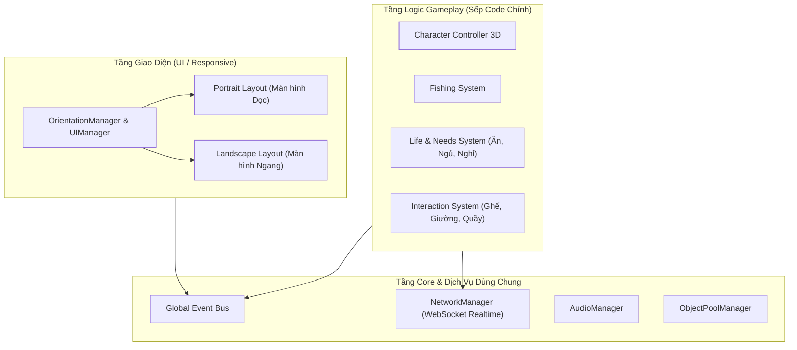

# 🏗️ KIẾN TRÚC KỸ THUẬT HỆ THỐNG (SYSTEM ARCHITECTURE)

## 1. MỤC TIÊU THIẾT KẾ
1. **Dễ cho Sếp code (Fresher-friendly):** Áp dụng mô hình hướng dịch vụ đơn giản (Service Locator / Singleton Manager có kiểm soát) kết hợp C# Action/Events để tách rời logic (Decoupled).
2. **Hỗ trợ tốt Hybrid Screen (Dọc + Ngang):** Không tạo 2 scene riêng biệt; một scene duy nhất với hệ thống `OrientationManager` tự động cập nhật Layout & Camera.
3. **Chạy mượt cả WebGL & Mobile:** Kiểm soát rác bộ nhớ (Zero/Low GC Allocation trong `Update`), sử dụng Object Pooling cho bóng cá, hiệu ứng, tin nhắn chat.

---

## 2. KIẾN TRÚC TỔNG THỂ DỰ ÁN



---

## 3. CẤU TRÚC THƯ MỤC SOURCE CODE CHUẨN TRONG `Assets/`

Sếp và Tech Lead sẽ tổ chức mã nguồn theo cấu trúc module rõ ràng sau:

```
Assets/
├── _Project/                     <-- Tất cả nội dung game tự làm để ở đây
│   ├── Art/                      <-- 3D Models, Materials, Textures, Shaders
│   │   ├── Characters/
│   │   ├── Environment/
│   │   └── Props/
│   ├── Audio/                    <-- BGM, SFX
│   ├── Prefabs/                  <-- Prefabs người chơi, vật phẩm, cá, UI
│   ├── Scenes/                   <-- Boot.unity, MainIsland.unity
│   ├── ScriptableObjects/        <-- Dữ liệu cá, item, cấu hình game
│   └── Scripts/                  <-- Mã nguồn C#
│       ├── Core/                 <-- GameManager, EventBus, OrientationManager
│       ├── Gameplay/
│       │   ├── Character/        <-- Di chuyển, Animation, Camera
│       │   ├── Interaction/      <-- Ghế, giường, ăn uống
│       │   └── Fishing/          <-- Câu cá, giật cần
│       ├── Network/              <-- Kết nối server, đồng bộ người chơi
│       └── UI/                   <-- ChatUI, Joystick, InventoryUI, EmoteWheel
```

---

## 4. CHIẾN LƯỢC XỬ LÝ MÀN HÌNH DỌC/NGANG (RESPONSIVE ORIENTATION)
Khi thiết bị đổi hướng hoặc người chơi bấm nút đổi chế độ hiển thị trên Web:
1. `OrientationManager` nhận diện tỉ lệ `Screen.width / Screen.height`.
2. Bắn sự kiện `OnOrientationChanged(ScreenOrientation mode)`.
3. Camera 3D tự động nội suy chuyển đổi:
   - **Màn dọc:** Tăng Camera Offset lên cao hơn một chút, thu hẹp FOV ngang để nhìn rõ cả nhân vật lẫn khung cảnh phía trước.
   - **Màn ngang:** Mở rộng góc FOV, Camera hạ thấp ngang vai để có chiều sâu không gian.
4. Canvas UI tự động đổi profile layout:
   - **Màn dọc:** Joystick và nút bấm dồn về 1/3 dưới màn hình (dễ với ngón cái bằng 1 tay), khung chat nằm ở giữa-dưới.
   - **Màn ngang:** Joystick góc trái dưới, nút bấm góc phải dưới, khung chat bên trái giữa.
