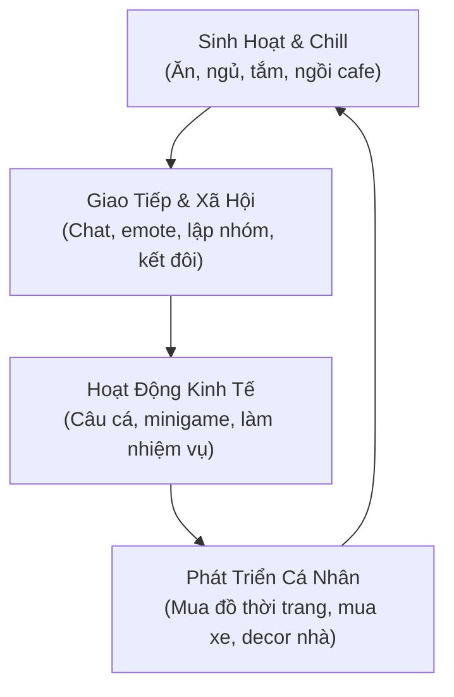

# 📘 GAME DESIGN DOCUMENT (GDD) - ĐẢO THIÊN ĐƯỜNG (PARADISE ISLAND)

## 1. KHÁI NIỆM & GIÁ TRỊ CỐT LÕI (CORE CONCEPT)
- **Tên dự án:** Đảo Thiên Đường (Paradise Island)
- **Cảm hứng:** Sự kết hợp hoàn hảo giữa **sự ấm cúng, đời sống xã hội của Avatar 2D (Teamobi)** và **không gian mở 3D sinh động, tính giải trí cộng đồng của Play Together**.
- **Thông điệp:** "Thế giới thứ hai của bạn - Nơi bạn sống, kết bạn, chill và giải trí không giới hạn."

---

## 2. VÒNG LẶP CỐT LÕI (CORE LOOP)

---

## 3. CÁC TÍNH NĂNG CHỦ ĐẠO (KEY FEATURES)

### 3.1. Hệ Thống Đời Sống (Living & Needs)
- **Chỉ số nhân vật:**
  - `Năng lượng (Energy)`: Giảm khi chạy, câu cá. Hồi phục bằng cách ngủ trên giường, ngồi ghế nghỉ ngơi hoặc uống cafe/trà sữa.
  - `Độ no (Hunger)`: Giảm dần theo thời gian. Tăng lại khi ăn đồ ăn ở quầy đồ ăn, quán xá.
  - `Cảm xúc (Happiness)`: Tăng khi tương tác với người chơi khác, câu được cá to, tham gia minigame.
- **Tương tác môi trường (Environmental Interactions):**
  - Ghế dài bãi biển, xích đu, quán bar, bàn ăn, giường ngủ. Người chơi chỉ cần lại gần bấm icon tương tác để nhân vật tự động thực hiện hành động.

### 3.2. Không Gian Giao Tiếp Realtime (Social Hub)
- **Chat thông minh:**
  - Hỗ trợ cả khung chat toàn kênh (Chat Log) và **Bong bóng chat (Chat Bubble)** trên đỉnh đầu nhân vật.
  - Tự động hiển thị emote icon cảm xúc bay lên khi gõ emoji.
- **Hệ thống Động tác (Emotes):** Vẫy tay chào, nhảy hiphop, bắn tim, khóc lóc, tức giận, nằm lăn lộn.
- **Tương tác đôi:** Nắm tay dạo biển, ôm, cõng nhau đi chơi.

### 3.3. Hoạt Động Câu Cá (Fishing System)
- **Bãi câu đa dạng:** Biển sâu, hồ nước ngọt, thác nước, bến tàu bãi biển.
- **Cơ chế bóng cá (Fish Shadows):** Kích thước bóng từ 1 đến 5 (từ cá mồi nhỏ đến cá mập/huyền thoại).
- **Minigame kéo cần:** Cá giật giật nhấp nhô $\to$ Xuất hiện biểu tượng `!` $\to$ Bấm kéo nhanh để giữ thanh lực trong vùng an toàn $\to$ Rút cá lên khoe trước mặt mọi người.

### 3.4. Hệ Thống Màn Hình Linh Hoạt (Hybrid Screen: Dọc & Ngang)
- **Màn hình dọc (Portrait Mode):** Tối ưu cho việc cầm 1 tay lướt dạo, vừa chat vừa uống nước, giao lưu xã hội nhẹ nhàng.
- **Màn hình ngang (Landscape Mode):** Tối ưu cho việc câu cá, điều khiển góc nhìn 3D bao quát, ngắm phong cảnh đảo và chơi mini-game phản xạ.
- **Cơ chế chuyển đổi (Seamless Auto-Switch):** Khi xoay thiết bị, UI tự động sắp xếp lại vị trí, Camera tự động tính lại Field of View (FOV) để không bị hẹp góc nhìn.
