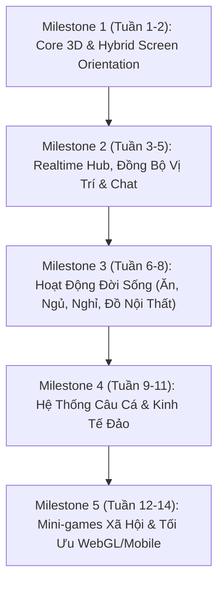

# 🗺️ LỘ TRÌNH PHÁT TRIỂN & TIMELINE (DEVELOPMENT ROADMAP)
> Dự án: **Đảo Thiên Đường (Paradise Island)**  
> Mục tiêu: Web Game & Mobile Game | Realtime 3D Social Sim | Màn hình Dọc + Ngang.

---

## 🧭 TỔNG QUAN TIMELINE (14 TUẦN TỪ PROTOTYPE ĐẾN ALPHA DEMO)

---

## 📌 CHI TIẾT TỪNG MILESTONE

### 🟢 Milestone 1: Nền Tảng Kỹ Thuật, 3D Controller & Màn Hình Dọc/Ngang (Tuần 1 - 2)
*Mục tiêu: Người chơi điều khiển nhân vật chạy nhảy mượt mà trong không gian 3D, xoay điện thoại ngang hay dọc camera và UI tự động chuyển mượt.*
- **Nhiệm vụ Tech Lead (Antigravity):**
  - Dựng kiến trúc `OrientationManager` (bắt sự kiện xoay màn hình dọc/ngang, đổi FOV camera, đổi layout Canvas).
  - Viết bộ Interface & Skeleton cho `CharacterController3D` và `ThirdPersonCamera`.
  - Cấu hình chuẩn đồ họa URP tối ưu cho WebGL (Shader nhẹ, Universal Renderer).
- **Nhiệm vụ Sếp (Fresher Dev):**
  - Viết logic di chuyển nhân vật (WASD trên PC / Joystick ảo trên Mobile), tương tác vật lý (nhảy, rơi trọng lực).
  - Ráp mô hình nhân vật placeholder và test chuyển đổi mượt giữa Portrait (dọc) và Landscape (ngang).
- **Kết quả đầu ra (Deliverable):** Demo chạy được trên PC WebGL và Mobile, xoay ngang dọc không bị vỡ giao diện.

---

### 🟡 Milestone 2: Thế Giới Online Realtime & Xã Hội Cơ Bản (Tuần 3 - 5)
*Mục tiêu: Nhiều người cùng vào 1 phòng, thấy nhau chạy, nói chuyện qua chat bong bóng và làm động tác (emote).*
- **Nhiệm vụ Tech Lead:**
  - Thiết lập hạ tầng Multiplayer (WebSocket / Colyseus server nhẹ chạy mượt trên WebGL & Mobile).
  - Thiết kế Network Message Protocol: Join Room, Player Spawn, Transform Sync, Chat Message, Emote Sync.
- **Nhiệm vụ Sếp:**
  - Viết code đồng bộ vị trí nội suy mượt (Interpolation), gửi gói tin vị trí.
  - Viết hệ thống UI Chat: Khung chat, bong bóng chat nổi trên đầu nhân vật (World Space UI / Screen Space).
  - Tích hợp vòng tròn Emote (vẫy tay, khóc, nhảy múa, chào hỏi).
- **Kết quả đầu ra:** Server local/cloud kết nối 10-20 người chơi cùng lúc trên Web và Điện thoại.

---

### 🟠 Milestone 3: Hoạt Động Đời Sống Xã Hội (Ăn, Ngủ, Nghỉ, Tương Tác) (Tuần 6 - 8)
*Mục tiêu: Đưa linh hồn đời sống vào game như Avatar/Play Together (ngồi ghế, ngủ trên giường, ăn uống).*
- **Nhiệm vụ Tech Lead:**
  - Thiết kế kiến trúc `InteractableObject` (ghế ngồi, giường nằm, quầy đồ ăn, máy bán hàng tự động).
  - Thiết kế hệ thống Chỉ số nhân vật: Năng lượng (Energy), Độ đói (Hunger), Độ vui vẻ (Fun).
- **Nhiệm vụ Sếp:**
  - Viết code bắt điểm `Snap Point` khi nhân vật ngồi vào ghế hoặc nằm lên giường (khóa di chuyển, phát animation).
  - Tạo logic tiêu thụ vật phẩm (cầm cốc trà sữa, ăn bánh burger, tăng thanh chỉ số).
- **Kết quả đầu ra:** Nhân vật có thể tụ tập vào quán cafe, ngồi nói chuyện, order đồ uống, đi về phòng ngủ lấy lại năng lượng.

---

### 🔴 Milestone 4: Hệ Thống Câu Cá & Vòng Lặp Kinh Tế (Tuần 9 - 11)
*Mục tiêu: Trọng tâm gây nghiện như Play Together - Cầm cần ra biển câu cá, giật cá, bán lấy tiền sắm đồ.*
- **Nhiệm vụ Tech Lead:**
  - Thiết kế công thức tỷ lệ cá (Lover fish, Shadow sizes, Rarity, Mini-game timing algorithm).
  - Thiết kế dữ liệu cá (ScriptableObject FishDatabase: cân nặng, độ hiếm, giá bán, thời gian xuất hiện).
- **Nhiệm vụ Sếp:**
  - Viết State Machine cho hành động câu: `Idle` $\to$ `Quăng cần (Cast)` $\to$ `Chờ bóng cá (Fish Spawning)` $\to$ `Cá cắn (Bite / Warning '!')` $\to$ `Kéo giật (Reel Mini-game)` $\to$ `Thành công (Show off popup)`.
  - Làm giao diện túi đồ (Inventory) và Shop bán cá / mua cần câu xịn.
- **Kết quả đầu ra:** Vòng lặp câu cá hoàn chỉnh, khoe cá với bạn bè xung quanh hồ nước.

---

### 🟣 Milestone 5: Mini-Games, Tối Ưu WebGL/Mobile & Alpha Test (Tuần 12 - 14)
*Mục tiêu: Thêm minigame nhóm, tối ưu tải trang cực nhanh trên Web (< 30MB) và test thực tế với bạn bè.*
- **Nhiệm vụ Tech Lead:**
  - Tối ưu bộ nhớ WebGL (Texture Compression WebP/ASTC, nén Audio, gộp Mesh/Material).
  - Thiết lập quy trình build tự động và lưu trữ dữ liệu người chơi trên Cloud.
- **Nhiệm vụ Sếp:**
  - Viết 1 minigame giải trí ngắn (ví dụ: Vượt chướng ngại vật / Ai là triệu phú câu hỏi vui / Đua thú).
  - Test tương thích trên nhiều kích cỡ màn hình điện thoại (tai thỏ, màn dài, màn iPad).
- **Kết quả đầu ra:** Bản Build WebGL playable online trên itch.io/Vercel và file APK chạy trên điện thoại Android.
